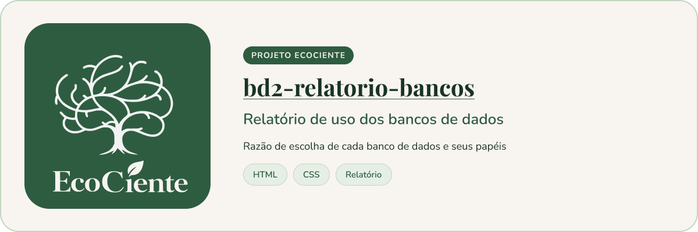

<p align="center">
  
</p>

# Relatório dos Bancos de Dados do EcoCiente


> Documento com evidências sobre como MongoDB, Qdrant, Redis, Neo4j e PostgreSQL entram no EcoCiente, com diagramas e um mapa interativo do esquema relacional.

## Sobre o projeto

Este repositório é o **documento de evidências** da disciplina de Banco de Dados 2: o anexo (ou o link) que mostra como cada banco é usado no EcoCiente. Ele reúne o que foi encontrado no código do projeto de IA (Eko) e nos esquemas SQL recebidos. A análise foi feita **sem conexão aos serviços**; quando algo está implementado mas não foi testado com dados reais, o texto diz isso.

O que está aqui:

- **Documentação textual** dos cinco bancos: [`documentacao-bancos-revisada.md`](documentacao-bancos-revisada.md) é a versão revisada; [`documentacao-bancos.md`](documentacao-bancos.md) é a versão anterior, mantida como registro.
- **Página para leitura e apresentação**: [`index.html`](index.html), com a mesma estrutura em formato navegável.
- **Mapa interativo do PostgreSQL**: [`modelo-postgresql-interativo.html`](modelo-postgresql-interativo.html), com as tabelas agrupadas por área e as chaves estrangeiras.
- **Diagramas SVG** em [`assets/`](assets/) (`modelo-mongodb.svg`, `modelo-neo4j.svg`, `modelo-qdrant.svg`, `modelo-redis.svg` e um por grupo de tabelas do PostgreSQL).
- **Scripts em Python** que geram os diagramas e os dados do mapa interativo.
- **PR Bot** (`.github/workflows/pr-bot.yml` e `scripts/pr-bot/`), que gera a descrição das pull requests.

## Pré-requisitos

- Para **ler** o relatório: apenas um navegador.
- Para **regenerar** os diagramas: Python 3.9 ou superior (desenvolvido com 3.14). Os scripts de diagramas usam só a biblioteca padrão.
- Para regenerar os diagramas do PostgreSQL: os três arquivos SQL de origem (export do pgAdmin, script do populador e script do Data Mart). Eles **não** fazem parte deste repositório.

## Instalando

```bash
git clone https://github.com/EcoCiente-Instituto-J-F/bd2-relatorio-bancos.git
cd bd2-relatorio-bancos
```

Não há dependências para instalar nos scripts de diagramas. As dependências do PR Bot (`google-genai`, `pydantic`, `requests`) ficam em `scripts/pr-bot/requirements.txt` e são instaladas pelo workflow.

## Usando

Para ler o relatório, abra `index.html` ou `modelo-postgresql-interativo.html` no navegador.

Para regenerar os artefatos (os caminhos dos SQLs são argumentos):

```bash
# Diagramas do PostgreSQL (assets/modelo-postgresql-*.svg)
python gerar_diagramas_postgresql.py EXPORT_PGADMIN.sql POPULADOR.sql DATA_MART.sql

# Dados do mapa interativo (assets/modelo-postgresql-dados.js)
python gerar_mapa_interativo.py EXPORT_PGADMIN.sql POPULADOR.sql DATA_MART.sql

# Diagramas do MongoDB e do Neo4j (assets/modelo-mongodb.svg e modelo-neo4j.svg)
python gerar_diagramas_mongo_neo4j.py
```

## Testes

O repositório não tem suíte de testes automatizada nem CI de testes. Depois de regenerar os arquivos, confira a mudança abrindo `modelo-postgresql-interativo.html` e os SVGs alterados no navegador.

## Estrutura do projeto

```
bd2-relatorio-bancos/
├── .github/workflows/
│   └── pr-bot.yml                       # gera a descrição das pull requests
├── assets/
│   ├── card-readme.png                  # card do README
│   ├── modelo-*.svg                     # diagramas de cada banco
│   ├── modelo-postgresql-dados.js       # metadados do mapa interativo (gerado)
│   └── modelo-postgresql-interativo.js  # lógica do mapa interativo
├── scripts/pr-bot/                      # script e dependências do PR Bot
├── documentacao-bancos-revisada.md      # documentação revisada
├── documentacao-bancos.md               # versão anterior
├── gerar_diagramas_postgresql.py
├── gerar_diagramas_mongo_neo4j.py
├── gerar_mapa_interativo.py
├── index.html                           # relatório em página única
├── modelo-postgresql-interativo.html    # mapa interativo do PostgreSQL
├── README.md
├── CONTRIBUTING.md
├── CODE_OF_CONDUCT.md
├── SECURITY.md
└── LICENSE
```

## Contribuindo

Leia o [CONTRIBUTING.md](CONTRIBUTING.md) antes de abrir um PR. Ao participar, você concorda com o [Código de Conduta](CODE_OF_CONDUCT.md).

## Segurança

Encontrou uma vulnerabilidade? Siga o [SECURITY.md](SECURITY.md). **Não abra issue pública.**

## Licença

Este projeto está sob a licença MIT. Veja o arquivo [LICENSE](LICENSE).
